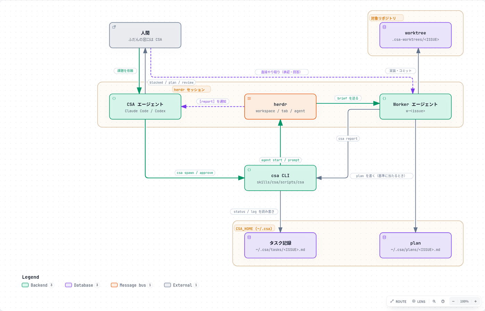
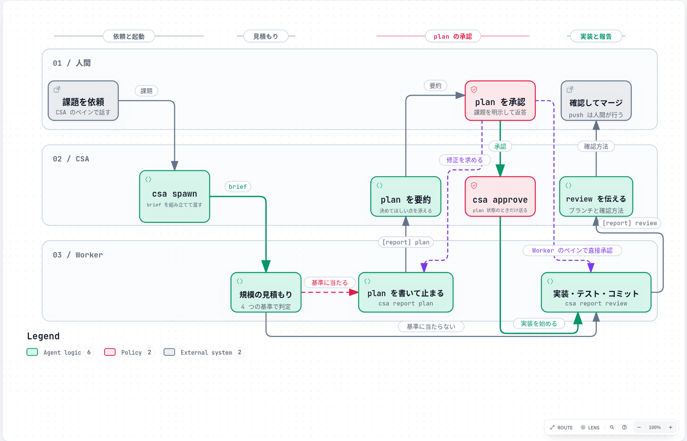

# chief-of-staff-agent-skill

[herdr](https://herdr.dev) 上で、人間の窓口になる 1 体のエージェント（CSA、Chief of Staff Agent）が、課題ごとに Worker エージェントを起動して仕事を割り振るためのキットです。
人間はふだん CSA と話し、CSA は Worker からの報告をまとめて、blocked、plan、review、判断が必要なことを人間に伝えます。
作業の途中では、人間が Worker のペインに移って直接やり取りすることもあります（[Worker と直接やり取りする](#worker-と直接やり取りする)）。

キットは [Agent Skills](https://agentskills.io) の形式の 2 つの skill として配布します。
主に Claude Code で使うことを想定していますが、skill の形式は仕様に沿っているので、Codex などほかのエージェントでも読み込めます。

| skill | 中身 |
|---|---|
| `csa` | CLI（`scripts/csa`）、CSA の手順、CSA の作業ディレクトリに置くテンプレート |
| `csa-worker` | Worker の決まりごと、着手前の見積もりと plan の手順、plan の雛形 |

```
workspace: csa                     workspace: <repo>(リポジトリごとに自動作成)
┌──────────────────────┐          ┌──────────────┬──────────────┐
│ csa (CSA)            │  spawn   │ tab PROJ-12  │ tab PROJ-15  │
│ cwd: ~/.csa          │─────────▶│ w-proj-12    │ w-proj-15    │
│ 人間のふだんの窓口   │◀─────────│ worktree     │ worktree     │
└──────────────────────┘  report  └──────────────┴──────────────┘
```

## 構成図

構成図は [archify](https://github.com/tt-a1i/archify) で作り、`docs/diagrams/` に置いています。
下の画像はプレビューです。
各要素の根拠になったソースの位置や補足のカードは、HTML 版で確かめられます（clone してブラウザで開いてください。GitHub 上では HTML がソースとして表示されます）。

### アーキテクチャ

人間、CSA、herdr、Worker、csa CLI と、タスク記録、plan、worktree の関係です。



HTML 版: [docs/diagrams/architecture.html](docs/diagrams/architecture.html)

### 課題の流れと plan の承認

Worker が見積もりで plan の要否を判定し、plan が要る課題では人間の承認を待ってから実装する流れです。



HTML 版: [docs/diagrams/task-workflow.html](docs/diagrams/task-workflow.html)

## 前提

次のツールは csa では入れません。それぞれの公式の手順で入れてください。
`csa init` と `csa doctor` は、これらがそろっているかを確かめ、足りないものを報告します。

- Linux、または macOS 12.3 以降（`readlink -f` を使うため）
- bash、git、[jq](https://jqlang.org)
- [herdr](https://herdr.dev)（動作を確かめたバージョンは 0.9.5）
- CSA と Worker に使うエージェント（既定は [Claude Code](https://code.claude.com)）
- インストールと更新に使う `npx skills` のための Node.js 22.20 以上（csa の実行には不要）
- curl（任意。新しいバージョンの確認に使う）

## インストール

```bash
npx skills add t2y/chief-of-staff-agent-skill -g -a claude-code --skill '*'
~/.claude/skills/csa/scripts/csa init
```

Codex でも使う場合は、`-a claude-code codex` のようにエージェントを並べます。
`--skill '*'` は、`csa` と `csa-worker` の両方を入れるための指定です。片方だけでは動きません。

`csa init` は次のことを行います。何度実行しても結果は同じです。

1. 前提のツールを確かめる。必須のものが欠けていれば、一覧を表示して何もせずに終わる。
2. `~/.local/bin/csa` に、skill の `scripts/csa` への symlink を作る。
3. `~/.csa`（`CSA_HOME`）に、状態ファイルと plan のディレクトリ、CSA 用のテンプレートを置く。

## 更新

```bash
npx skills update -g
```

`csa up` と `csa doctor` は、新しいバージョンが出ていれば知らせます（1 日に 1 回 GitHub に問い合わせます）。
自動では更新しません。問い合わせを止めるには `CSA_UPDATE_CHECK=0` を設定します。
テンプレートの更新は、次に `csa up` を実行したときに `~/.csa` へ反映されます。

## 使い方

herdr に接続した状態で、どこかのシェルペインから CSA を起動します。

```bash
csa up
```

`csa` という名前のエージェントが、作業ディレクトリ `~/.csa` で起動します。
あとは CSA のペインに課題を話しかけます。

```
PROJ-12: ~/src/app の SCIM PATCH で replace の path なしのときに 500 になる。
再現テストを書いてから直して。テストは go test ./scim/...
```

CSA は brief を組み立てて `csa spawn` を実行し、そのリポジトリの worktree（`.csa-worktrees/PROJ-12`、ブランチ `csa/PROJ-12`）で Worker を起動します。

Worker は実装を始める前に規模を見積もります。
変更するファイルが 4 つ以上になる、複数のモジュールにまたがる、公開 API やスキーマが変わる、要件が曖昧で設計の選択肢が複数ある、のどれかに当てはまる課題では、`~/.csa/plans/<ISSUE>.md` に plan を書いて止まります。
CSA が plan を要約して伝えるので、人間が承認すると Worker が実装を始めます。

### Worker と直接やり取りする

課題が進む途中で、人間が Worker と直接やり取りする場面は普通にあります。
たとえば次のような場面です。

- Worker が承認の確認（コマンドの実行、フォルダの信頼など）で止まり、人間がそのペインで承認する。
- Worker の質問に答えたり、画面を見ながら細かい指示を出したりする。
- 実装の途中経過を見て、方針を直接伝える。

Worker のペインは、herdr でそのリポジトリの workspace に移り、課題 ID の名前の tab を開くと見つかります（`prefix+w` で workspace を切り替えます）。

Worker は、人間からの直接の指示にも CSA からの指示と同じように従います。
ただし、CSA は直接のやり取りの中身を知りません。
そのため Worker は、人間とのやり取りで状態や方針が変わったら `csa report` で記録します。
CSA はタスク記録と `[report]` から最新の状況を知るので、`csa status` の表示も実際の状況とずれません。
方針を大きく変えたときは、CSA にも一言伝えておくと、その後の要約や判断に反映されます。

| コマンド | 役割 |
|---|---|
| `csa init` | 前提を確かめ、csa を PATH に置き、`~/.csa` を用意する |
| `csa up` | CSA エージェントを起動する |
| `csa doctor` | 前提と設定を確かめる（何も変更しない） |
| `csa version` | バージョンと skill の場所を表示する |
| `csa spawn <ISSUE> <repo> -` | Worker を起動して brief（標準入力）を渡す |
| `csa status` | 課題の一覧を表示する |
| `csa report <ISSUE> <status> <note>` | Worker が状態を報告する |
| `csa approve <ISSUE> [note]` | 承認された plan の実装開始を Worker に伝える |
| `csa peek <ISSUE> [lines]` | Worker の画面を読む |
| `csa close <ISSUE>` | Worker の tab を閉じる（worktree は残す） |

## エージェントごとの設定

Claude Code 2.1.325 と Codex CLI 0.169.0 で、CSA と Worker の両方の組み合わせを確かめています。

### Claude Code

CSA 用の権限設定は `~/.csa/.claude/settings.json` に置かれます。
CSA は Edit と Write を禁止されており、コードを書けません。

Worker は対象リポジトリで起動するので、`~/.claude/settings.json` の `permissions.allow` に次を足しておくと、報告と plan の書き込みのたびに止まらずに済みます。
`csa init` は、これらがなければ足すべき行を表示します。

```json
"Bash(csa report:*)",
"Edit(~/.csa/plans/**)",
"Write(~/.csa/plans/**)"
```

### Codex

`CSA_KIND=codex` で CSA を、`CSA_WORKER_KIND=codex` で Worker を Codex で起動します。
CSA の決まりごとは `~/.csa/AGENTS.md` に書かれているので、Codex でも Claude Code でも同じ決まりで動きます。
`CSA_WORKER_KIND` は `csa spawn` を実行するシェルの環境変数なので、CSA を起動する前（`csa up` の前）に設定してください。

Codex の既定のサンドボックスでは、worktree の外への書き込みと herdr への接続が止められます。
そのため、何も設定しないと、Worker の報告やコミット、CSA の状況確認のたびに承認を求められます。
次の 2 つを設定すると、Claude Code の設定と同じ範囲で確認なしに進みます（Codex CLI 0.169.0 で確認）。

`~/.codex/rules/default.rules` に次を足します。

```python
# Worker の報告とコミット
prefix_rule(pattern = ["csa", "report"], decision = "allow")
prefix_rule(pattern = ["git", "add"], decision = "allow")
prefix_rule(pattern = ["git", "commit"], decision = "allow")
# CSA が状態を確かめる操作と、人間が承認した plan を伝える操作
prefix_rule(pattern = ["csa", ["status", "peek", "version", "doctor", "approve"]], decision = "allow")
prefix_rule(pattern = ["herdr", "agent", ["get", "list", "read", "wait"]], decision = "allow")
prefix_rule(pattern = ["gh", "issue", "view"], decision = "allow")
```

`~/.codex/config.toml` に、plan の保存先への書き込みを足します（パスは `CSA_PLANS_DIR` の絶対パス）。

```toml
[sandbox_workspace_write]
writable_roots = ["/home/<you>/.csa/plans"]
```

設定は Codex の起動時に読まれるので、変更後は CSA と Worker を起動し直してください。
次の 2 点に注意してください。

- Codex の規則はユーザー全体に効きます。CSA と Worker 以外の Codex セッションでも、上のコマンドは確認なしで実行されます。
- `allow` にしたコマンドは、サンドボックスの外で実行されます。

`csa spawn`、`csa close`、`herdr agent prompt` は、Claude Code と同じく自動では許可しません。CSA がこれらを実行するたびに、人間が承認します。

### フォルダの信頼の確認

Claude Code と Codex は、初めて開くフォルダで「このフォルダを信頼しますか」と確認します。
`csa spawn` は課題ごとに新しい worktree を作るので、Worker が起動直後にこの確認で止まることがあります。
この場合、`csa spawn` は brief を送らずにタスクを `blocked` として記録し、CSA が人間に知らせます。
人間が Worker のペインで承認したあと、CSA が同じ `csa spawn` を再実行すると、brief が 1 回だけ送られます。

確認の頻度は次のとおりでした。

- **Codex**：信頼はリポジトリのルートに保存されるので、確認はリポジトリごとに 1 回です。ホームディレクトリなどの上位を信頼済みなら確認は出ません。
- **Claude Code**：同じリポジトリの 2 つ目以降の worktree では確認が出ませんでした。

### Worker の報告が CSA に届かないとき

Worker の `csa report` は、タスクファイルを更新したあと、CSA のペインに `[report]` を送ります。
CSA が承認の確認などで止まっている間は送信が拒否されますが、報告はタスクファイルに残るので、CSA は `csa status` で拾えます。

## カスタマイズ

`~/.csa` の `AGENTS.md`、`CLAUDE.md`、`.claude/settings.json` は、`csa init` と `csa up` のたびに上書きされます。
自分用の追記は次のファイルに書いてください。csa はこれらを上書きしません。

| ファイル | 用途 |
|---|---|
| `~/.csa/AGENTS.local.md` | CSA の決まりごとへの追記 |
| `~/.csa/CLAUDE.local.md` | Claude Code の CSA だけに効かせる追記 |
| `~/.csa/.claude/settings.local.json` | CSA の権限設定への追記 |
| `~/.csa/worker.local.md` | Worker の決まりごとへの追記 |

| 環境変数 | 既定値 | 意味 |
|---|---|---|
| `CSA_HOME` | `~/.csa` | 状態と CSA の作業ディレクトリ |
| `CSA_PLANS_DIR` | `$CSA_HOME/plans` | plan の保存先 |
| `CSA_KIND` | `claude` | CSA に使うエージェント（`herdr agent start --kind` の値） |
| `CSA_WORKER_KIND` | `claude` | Worker に使うエージェント |
| `CSA_PUSH` | `1` | `0` にすると、Worker の報告を CSA のペインに送らない（`csa status` でだけ確認する） |
| `CSA_UPDATE_CHECK` | `1` | `0` にすると、新しいバージョンの確認をしない |
| `CSA_BIN_DIR` | `~/.local/bin` | `csa` の symlink を置く場所 |

## アンインストール

```bash
npx skills remove -g csa csa-worker
rm ~/.local/bin/csa
rm -rf ~/.csa   # 課題の記録と plan も消えます
```

対象リポジトリの `.csa-worktrees/` と `csa/*` ブランチは残るので、必要に応じて `git worktree remove` と `git branch -D` で消してください。

## 開発

```bash
mise install      # shellcheck と bats
mise run lint
mise run test
```

テストは偽の herdr（`test/fake-bin/herdr`）を使うので、herdr がなくても実行できます。
手元の clone をそのまま入れて試すには、`npx skills add <clone のパス> -g -a claude-code --skill '*'` を実行します。

## ライセンス

MIT
